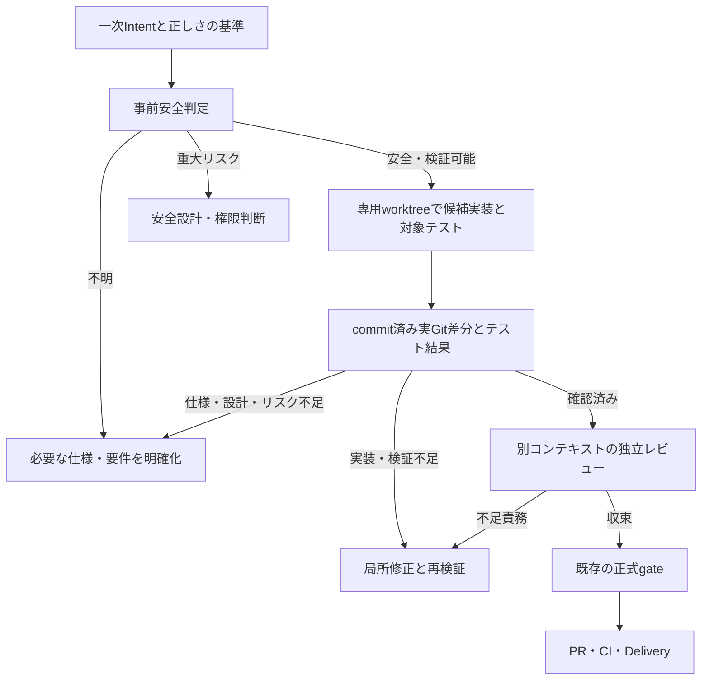

# Issue #1576 実装先行・証拠駆動の実行設計

## 決定と現状

利用者Intentの正しさの基準が明確で、隔離候補を安全に作れる場合は、候補実装と対象テストを先に作り、実Git差分から不足責務を選択する。認可、データ破壊、外部互換性などの重大リスクや仕様未確定がある場合は、先に必要な上流判断を行う。変更行数の合計点では判定しない。

このPRの実装は、新モデルを既存の正式契約に接続する候補判定と部分的な正式採用層である。`workflow candidate`の出力は`authority: none`で、Step記録、Planning Seal、AMD、review session、検証、Deliveryを変更・承認しない。明示的な`workflow candidate-adopt`だけが封印済みquick stagingと収束済み採用前reviewの下で採用記録を追加する。`workflow advance`とStep 0〜11が引き続き正式な状態遷移を所有する。封印済みquickの結果用worktreeで採用前reviewが同じbase・HEADに収束していれば、`workflow advance --plan`は通常のStep 9実装Workerを再起動せず、`workflow candidate-adopt`のCLI採用を次の作業として返す。これは助言であり、`--apply`が既存gateを再検証する。通常の`workflow advance` previewも`--plan`と同じ選択結果からdispatchを導出し、正式検証が先ならreviewerを起動しない。ただし既存previewの工程判定・終了値は維持し、Gitやreview記録を観測できないときは`executionState: blocked`と理由を別に返してdispatchしない。採用前reviewが収束してStep 10のroleがcoordinatorでも、正式検証が欠けるならCLI検証を先に選び、成功後に再planしてreview exportへ進む。Step 11はreview済み提出要約がない既存作業には本文とEvidenceの互換入力を案内し、要約がある場合だけ`--from-summary`を選択可能とする。Step 11はPR作成前・PR固定後・merge照合中の保存済み状態と既定branchのtrusted merge方針で許可操作を選び、`pr merge`自身が権限・HEAD・GitHub状態を再検証する。明確な低リスクかつquick適格な指示は標準入口で候補経路へ振り分ける。候補の正式採用は既存gateを再観測して行う。認可等の高リスクまたは不明条件では上流判断を先行させる。同一条件の性能優位性や全Agent tokens削減はまだ実証していない。

ソースの境界は、正式なStepと遷移が`src/domain/workflow.ts`、作業契約が`src/adapters/workflow-execution-plan.ts`と`src/adapters/workflow-handoff.ts`、既存保証の投影が`src/adapters/workflow-assurance.ts`、候補の純粋判定が`src/domain/candidate-workflow.ts`、実Git観測が`src/adapters/candidate-git.ts`、CLI入口が`src/cli.ts`である。

## 候補の状態と責務

`workflow candidate --input=<JSON> --repo=<専用worktree> --session=<候補worktree外の新規file>`には`preflight`と`post`がある。事前入力は一次Intent、正しさの基準、**実装前に固定する**許可path、14領域のリスク状態、未解決事項を持つ。リスク入力は呼出者の**申告**であり、正式なtrusted policyや承認ではない。CLIはGit HEADとリンクworktreeを観測し、どれか1つでも重大リスクがtriggeredなら上流、unknown・基準不足・隔離不足ならclarifyを返す。候補作業は外部操作や正式Evidenceの作成を許可しない。`phase: execute`ではWorkerを一時的なリンクworktreeへ閉じ込め、許可された通常fileのsnapshotからprivate indexとcommit objectを作り、新しい結果用リンクworktreeへ展開する。通常の`workerArgv`はhost隔離で実行する。明示的な`workerProvider: codex`では認証を持つCodex本体をCoordinator側から起動し、モデルが実行するtoolだけを候補worktreeの読取・許可source directoryの書込・ネットワーク禁止のpermission profileへ閉じ込める。CLIはWorker内のmulti-agent・Web検索・MCPアプリ機能を無効にし、Codex JSONLの`turn.completed` usageを検証して`workerUsage`へ記録し、Worker実行時間を別に記録する。欠測や不正usageは`null`とし、全Agent合計と推定しない。Workerが許可外の認可fileを書き換えても一時worktreeとともに破棄し、呼出元の候補worktreeのHEAD・index・fileは変更しない。CoordinatorのGit操作はhook・fsmonitorを無効にし、commitまたはindexに`.gitattributes`を含むrepository、およびlocal属性にfilter指定を含むrepositoryでは候補実行を停止する。assume-unchanged・skip-worktree等の隠蔽index flagも事前に拒否する。これらはLinux host隔離が起動できる場合の候補安全境界であり、正式Evidenceではない。candidate経路だけで作るsessionは候補worktree外に排他的に保存するローカル引継ぎ記録であり、正式Evidenceではない。

事後入力は不足責務と対象テストのargvだけを持つ。base SHA、許可path、成功フラグの事後申告は拒否し、sessionの実装前HEADと範囲を使う。CLIは実HEAD、clean status、baseの祖先関係、renameを分解した実差分を再計算し、対象テストをshellを通さず実行して終了値と出力digestを観測する。HEADやworktreeが実行中に変われば拒否する。この対象テスト観測はtrusted policyで承認された`verify run`の正式記録ではなく、独立reviewと正式検証が引き続き必要である。Git基点は`origin/HEAD`が存在すればそれとの分岐点、無ければ主worktreeのHEADとの分岐点を再計算する。基点の追随遅れや更新で正当な候補も拒否し得るため、その場合は基点を確認して新しい候補worktreeから再開する。別の基点へ黙って切り替えない。テスト自体が弱い場合もある。未解決責務はすべて保持し、想定外のセキュリティ関連pathは上流へ戻す。問題が無ければ独立reviewを要求するだけで、正式reviewを自動的に満たさない。

sessionとローカルGit参照は同一ローカル利用者が書き換え可能であり、これらの照合だけでは改ざん耐性のある正式状態への昇格根拠にはできない。セキュリティ影響がpath名に現れない場合や非セキュリティpathの許可範囲改ざんも残る。リスクの`cleared`も独立した裏付けがない。正式経路へ取り込む前に、既存のjournal・trusted policy・review・検証記録と照合する昇格契約が必要である。今回の隔離dummyでは、弱い対象テストが通ったまま認可回帰を注入すると、許可外の認可差分で`upstream`となり、独立オラクルも失敗した。これを品質同等性や開発速度改善の実証とは扱わない。

## 候補commitの公開と失敗時境界

`phase:execute`ではWorkerを使い捨てlinked worktreeで走らせ、Coordinatorが許可された通常fileの内容を上限内でsnapshotする。private indexへのblob・tree登録と`commit-tree`で候補commit objectを作り、**元候補worktreeのfile・index・HEADは変更しない**。そのcommitを予測困難な新規linked worktreeに展開し、対象テストとGit観測をそこで実行する。結果には新しい`candidateWorktree`を返す。対象テストのsandboxには元候補の親directoryや共有tmp全体の読取を与えず、実行file自身だけを個別に読取許可し、別worktree内の実行fileも拒否する。repository hookとfilterは起動しない。候補は`authority:none`であり、正式Evidenceにはならない。

| 失敗点 | 元候補と出力の扱い |
| --- | --- |
| Worker、snapshot、private index、`commit-tree` | 元候補は未変更。使い捨てWorker worktreeを破棄する。 |
| 新規出力worktreeの作成・検証失敗 | 元候補は未変更。部分的な出力worktreeを破棄し、正式採用しない。 |
| 元候補のHEAD・fileが並行変更された場合 | 並行編集を上書きしない。新規出力の公開を拒否し、元候補の変更を保持する。 |
| 対象テスト失敗 | 新規worktreeの候補commitと失敗観測を返す。修正の再試行には別の新規候補を使い、失敗commitを正式承認へ昇格しない。 |
| 新規出力worktree作成後の異常終了 | 未参照のGit worktree登録が残る可能性がある。正式Evidenceにはならず、運用者がGit worktreeを検分・破棄する。 |

元候補のfile・index・HEADを原子的に更新する必要がない構成であり、同じworktreeへの前向き取込・競合時の自動巻戻しは行わない。新規出力worktreeはdetached HEADである。正式Workflowへ接続する際には、新しいworktreeの実HEAD・差分・独立reviewを採用前に照合する。`workflow candidate-adopt`がその採用記録を担い、trusted verificationとStep 10・Deliveryは後続gateで照合する。

成功した結果用worktreeの暫定所有者はCandidate呼出者であり、`candidateWorktree`と観測HEADを引き継ぐ。独立レビュー、正式採用、明示破棄のいずれかが決まるまで保持する。`workflow candidate-inventory --repo=<作成元worktree>`は、同じ親directoryの結果用pathをGit登録と実directoryから読み取り専用で照合し、`registered-clean`、`registered-modified`、`registered-missing`、`registered-unknown`、`unregistered-directory`、`unregistered-path`を区別する。未知・変更済み・孤立状態を自動削除しない。正常終了後も自動pruneしないため、正式採用前の成果物を失わない。

破棄を選ぶ場合、所有者は対象pathとHEADを再観測し、差分・未追跡・ignored成果物と他worktreeの登録を確認した上で、cleanな対象だけをGitの`worktree remove`で明示的に外す。異常終了でdirectoryだけが残る場合は所有者が内容と登録の不存在を確認し、登録だけが残る場合は`git worktree prune --dry-run --expire=now`でrepository全体の対象を確認する。他の登録も対象になるなら一括pruneを実行しない。既存の`worktree survey`と`hygiene`は通常のbranch付きworktreeやrepository内残骸向けであり、このdetached結果を自動破棄する権限にはしない。正式採用時にはjournalの採用記録が候補HEADの正式参照を引き継ぐ。結果用worktreeの破棄・回収はなお所有者の明示操作であり、既存の正式finalize gateへ自動接続する機構は未実装である。

## 正式昇格に必要な信頼境界

ローカルSessionとローカルGit参照は同一利用者権限のWorkerから変更可能であり、ハッシュ・別ディレクトリ・mutation lockだけでは原本性を保証できない。正式経路では、AIの候補Workerと状態遷移を所有するCoordinatorを実行権限で分離する。Coordinatorが一次Intentと正しさの基準を受け取り、Git基点・許可範囲・リスク根拠をWorker起動前に記録する。Workerには候補sourceだけの書込を許し、Session、staging、Git common directory、trusted policy、Coordinatorの認証情報を書き換えさせない。Git commitと正式記録はCoordinatorが観測後に行う。この境界をhostが強制できない場合、Candidateの正式昇格を停止し既存Workflowへ戻す。

昇格時には、実Git差分を基点から再観測し、現在HEADでのtrusted policyに沿う正式検証記録、実装者から独立したreview session、未解決責務、Planning Seal/AMD、Delivery権限を一緒に照合する。現在の採用経路は最初のcommitの件名と履歴形状を検査するが、Coordinatorの事前記録との照合は行わない。従って件名をCoordinatorによる生成の証明とは扱わず、出自は`git-lineage-only`、`coordinatorOriginVerified: false`として表示する。正式採用は出自の自己申告ではなく、元Intent・実差分・独立reviewと既存gateによる内容検分に依拠する。対象テストの任意argv成功やCandidateの`authority:none`出力は正式検証・承認として採用しない。Step 9を事後的な実装作業と偽装しない。`workflow candidate-adopt`は低リスクquickのStep 4封印・書き込み後読み取り済み同期の後、結果用worktreeの直前commitと採用時に固定したtrusted既定branch tipとの一意な分岐点・累積実差分・要求digestを再計算し、`candidateAdoption`を持つStep 9 journal遷移として「既存Candidateの採用時点」を明示する。採用前に同じ結果用worktreeで既存の`review round`を開き、元Intent・実Git差分・既存契約を独立に検分する。review sessionは封印済みquick Step 4とCandidate exact HEADに束縛し、未収束・最終review済みHEAD/累積差分不一致なら`--apply`を拒否する。指摘修正は最初のCandidate commitから単一直列のcommitとして進め、同じsessionで再reviewした最終HEADだけを採用する。Previewは副作用なし、`--apply`だけが採用前に固定したstaging digestとの一致をlock内で再確認して追記する。候補のrisk・gaps・任意targetTest成功は正式Evidenceに昇格しない。採用後もStep 10正式記録、trusted full検証、Delivery gateを実行する。標準入口は低リスクquickに限って接続した。意味的な不足責務の判断はAIが持ち、未知を自動で満足へ昇格させない。旧方式との同条件の時間・全Agent tokens比較は未完了である。

## 正式経路への移行条件

1. 一次Intent、既存契約、Planning Seal/AMD、append-only journal、trusted policy、exact HEAD、独立review、検証・Delivery・人間承認の各不変条件について、新候補から正式stateへの**機械検証可能な昇格規則**を定義する。候補commitをStep 9の実施記録として偽装しない。
2. 高リスク・曖昧要求・仕様矛盾・隠れた回帰・不正Evidence・異常終了・再開・Provider障害を含むGherkinと隔離E2Eで、旧経路と同じoracle・review・CI条件を満たす。新しいgateが不明をsatisfiedに格上げしないことを確認する。
3. 同一の要求とアクセス可能資料をそろえ、旧ASC、新ASC、ASCなしを比較する。親agentと全workerのinput/output/cacheを含む総tokens、critical path、再試行、欠測を記録する。欠測は`null`とし、単発の削減率を因果効果と呼ばない。
4. 明確で低リスク・quick適格な変更だけは標準入口でCandidateを先に試す。正式契約は既存Step 0〜11とし、Candidate失敗時は停止または既存Step経路へ戻す。高リスクへの対象拡大や一般的な性能改善の主張には、同条件比較と追加の反例検証を要する。

## 実測と限界

比較可能な隔離Case Aの現行ASC試行では、実装前Step 0/1/2/3/5/6/7がworker処理tokensの67.55%、要求からCIまでの時間の80.27%に相当した。これは削減可能量ではない。Step 3/7のblocking findingは0件だが、境界や反例を検分しており価値ゼロとは言えない。別の旧候補比較は配布物へのアクセス条件が異なるため、採用根拠にしない。親agentのtokens、context high-water mark、cache内訳は欠測である。既存Evidenceの詳細はPR #1577本文と隔離試行のSHA-256記録を参照する。

### 2026-10-12 Codex Provider隔離probe

独立Git dummyでCodex CLI 0.153.4を`workerProvider: codex`として1回実走した。文言`Helo`→`Hello`の候補を新しい結果用worktreeへ発行し、Node対象テストが成功、元候補と主worktreeのHEAD・sourceは不変だった。multi-agent・Web検索・MCPアプリ無効化後の実測は、CLI起動から結果まで27.69秒、Worker実行26,626 ms、Provider報告のinput 96,628、cache read 88,448、cache write 0、output 369、reasoning output 23 tokensである。別途、permission profileが許可外fileの書込を拒否することも隔離dummyで確認した。この単発probeは正式採用・PR/CIまでの完走でも、旧ASCやASCなしとの同条件比較でもない。親agentと他Workerのtokensは含まない。

### 2026-10-13 Candidateからprivate PR/CIまでの実走

[隔離E2E記録](../../reviews/1576_implementation_first_e2e.md)で、Codex Candidate実装、同一HEADの独立review再利用、quick正式採用、trusted full検証、PR作成、GitHub CI成功まで確認した。この単発試行は旧ASC・ASCなしとの同条件比較ではなく、全Agent tokensも欠測である。
