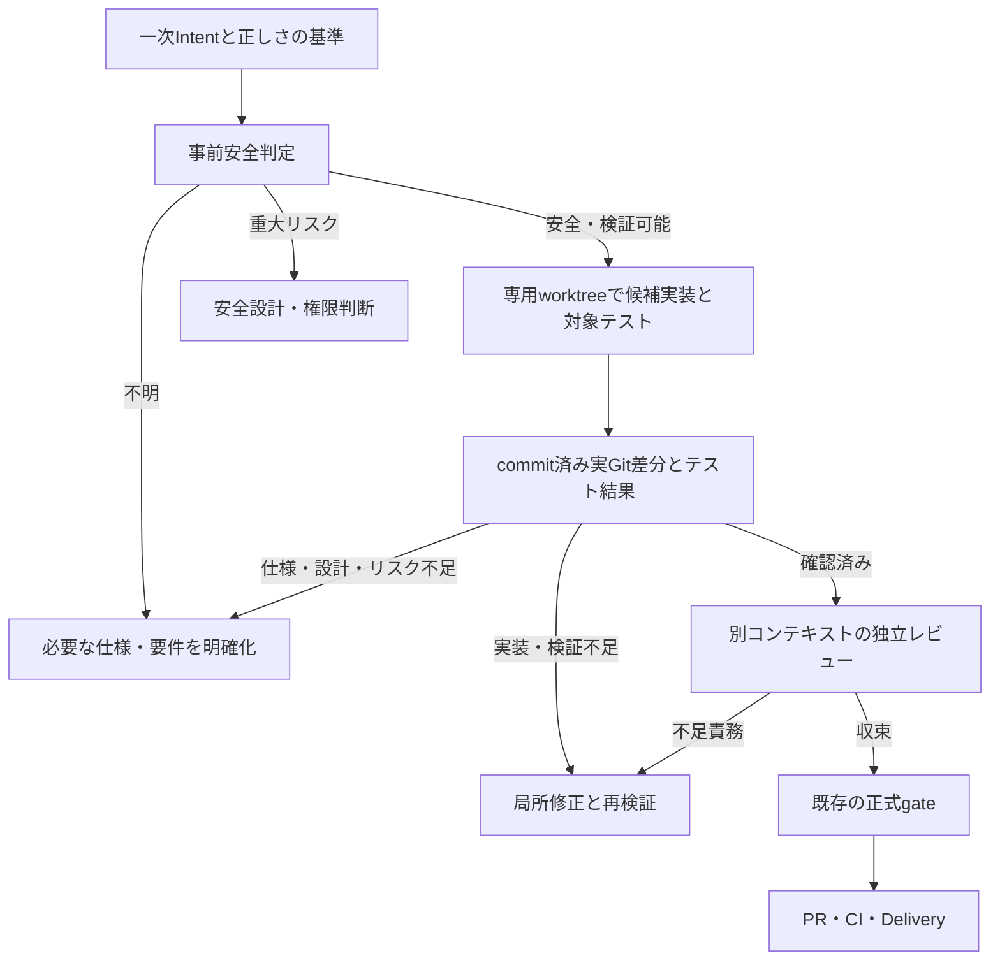

# Issue #1576 実装先行・証拠駆動の実行設計

## 決定と現状

利用者Intentの正しさの基準が明確で、隔離候補を安全に作れる場合は、候補実装と対象テストを先に作り、実Git差分から不足責務を選択する。認可、データ破壊、外部互換性などの重大リスクや仕様未確定がある場合は、先に必要な上流判断を行う。変更行数の合計点では判定しない。

このPRの実装は、新モデルを既存の正式契約に接続する**候補判定層**である。`workflow candidate`の出力は`authority: none`で、Step記録、Planning Seal、AMD、review session、検証、Deliveryを変更・承認しない。`workflow advance`とStep 0〜11が引き続き正式な状態遷移を所有する。候補経路を正式な既定経路へ切り替えるのは、下記の同等性検証と新しいgateの実装後に限る。この制限のため、現時点でIssue全体の開発時間やtoken削減を実証したとは扱わない。

ソースの境界は、正式なStepと遷移が`src/domain/workflow.ts`、作業契約が`src/adapters/workflow-execution-plan.ts`と`src/adapters/workflow-handoff.ts`、既存保証の投影が`src/adapters/workflow-assurance.ts`、候補の純粋判定が`src/domain/candidate-workflow.ts`、実Git観測が`src/adapters/candidate-git.ts`、CLI入口が`src/cli.ts`である。

## 候補の状態と責務

`workflow candidate --input=<JSON> --repo=<専用worktree> --session=<候補worktree外の新規file>`には`preflight`と`post`がある。事前入力は一次Intent、正しさの基準、**実装前に固定する**許可path、14領域のリスク状態、未解決事項を持つ。リスク入力は呼出者の**申告**であり、正式なtrusted policyや承認ではない。CLIはGit HEADとリンクworktreeを観測し、どれか1つでも重大リスクがtriggeredなら上流、unknown・基準不足・隔離不足ならclarifyを返す。候補作業は外部操作や正式Evidenceの作成を許可しない。`phase: execute`ではWorkerを一時的なリンクworktreeへ閉じ込め、許可された通常fileのsnapshotからprivate indexとcommit objectを作り、新しい結果用リンクworktreeへ展開する。Workerが許可外の認可fileを書き換えても一時worktreeとともに破棄し、呼出元の候補worktreeのHEAD・index・fileは変更しない。CoordinatorのGit操作はhook・fsmonitorを無効にし、commitまたはindexに`.gitattributes`を含むrepository、およびlocal属性にfilter指定を含むrepositoryでは候補実行を停止する。assume-unchanged・skip-worktree等の隠蔽index flagも事前に拒否する。これらはLinux host隔離が起動できる場合の候補安全境界であり、正式Evidenceではない。candidate経路だけで作るsessionは候補worktree外に排他的に保存するローカル引継ぎ記録であり、正式Evidenceではない。

事後入力は不足責務と対象テストのargvだけを持つ。base SHA、許可path、成功フラグの事後申告は拒否し、sessionの実装前HEADと範囲を使う。CLIは実HEAD、clean status、baseの祖先関係、renameを分解した実差分を再計算し、対象テストをshellを通さず実行して終了値と出力digestを観測する。HEADやworktreeが実行中に変われば拒否する。この対象テスト観測はtrusted policyで承認された`verify run`の正式記録ではなく、独立reviewと正式検証が引き続き必要である。Git基点は`origin/HEAD`が存在すればそれとの分岐点、無ければ主worktreeのHEADとの分岐点を再計算する。基点の追随遅れや更新で正当な候補も拒否し得るため、その場合は基点を確認して新しい候補worktreeから再開する。別の基点へ黙って切り替えない。テスト自体が弱い場合もある。未解決責務はすべて保持し、想定外のセキュリティ関連pathは上流へ戻す。問題が無ければ独立reviewを要求するだけで、正式reviewを自動的に満たさない。

sessionとローカルGit参照は同一ローカル利用者が書き換え可能であり、これらの照合だけでは改ざん耐性のある正式状態への昇格根拠にはできない。セキュリティ影響がpath名に現れない場合や非セキュリティpathの許可範囲改ざんも残る。リスクの`cleared`も独立した裏付けがない。正式経路へ取り込む前に、既存のjournal・trusted policy・review・検証記録と照合する昇格契約が必要である。今回の隔離dummyでは、弱い対象テストが通ったまま認可回帰を注入すると、許可外の認可差分で`upstream`となり、独立オラクルも失敗した。これを品質同等性や開発速度改善の実証とは扱わない。

## 候補commitの公開と失敗時境界

`phase:execute`ではWorkerを使い捨てlinked worktreeで走らせ、Coordinatorが許可された通常fileの内容を上限内でsnapshotする。private indexへのblob・tree登録と`commit-tree`で候補commit objectを作り、**元候補worktreeのfile・index・HEADは変更しない**。そのcommitを予測困難な新規linked worktreeに展開し、対象テストとGit観測をそこで実行する。結果には新しい`candidateWorktree`を返す。対象テストのsandboxには元候補の親directoryや共有tmp全体の読取を与えず、実行file自身だけを個別に読取許可し、別worktree内の実行fileも拒否する。repository hookとfilterは起動しない。候補は`authority:none`であり、正式Evidenceにはならない。

| 失敗点 | 元候補と出力の扱い |
| --- | --- |
| Worker、snapshot、private index、`commit-tree` | 元候補は未変更。使い捨てWorker worktreeを破棄する。 |
| 新規出力worktreeの作成・検証失敗 | 元候補は未変更。部分的な出力worktreeを破棄し、正式採用しない。 |
| 元候補のHEAD・fileが並行変更された場合 | 並行編集を上書きしない。新規出力の公開を拒否し、元候補の変更を保持する。 |
| 対象テスト失敗 | 新規worktreeの候補commitと失敗観測を返す。修正の再試行には別の新規候補を使い、失敗commitを正式承認へ昇格しない。 |
| 新規出力worktree作成後の異常終了 | 未参照のGit worktree登録が残る可能性がある。正式Evidenceにはならず、運用者がGit worktreeを検分・破棄する。 |

元候補のfile・index・HEADを原子的に更新する必要がない構成であり、同じworktreeへの前向き取込・競合時の自動巻戻しは行わない。新規出力worktreeはdetached HEADである。正式Workflowへ接続する際には、新しいworktreeの実HEAD・差分・trusted verification・独立reviewを改めて照合する専用の採用契約が必要である。

## 正式昇格に必要な信頼境界

ローカルSessionとローカルGit参照は同一利用者権限のWorkerから変更可能であり、ハッシュ・別ディレクトリ・mutation lockだけでは原本性を保証できない。正式経路では、AIの候補Workerと状態遷移を所有するCoordinatorを実行権限で分離する。Coordinatorが一次Intentと正しさの基準を受け取り、Git基点・許可範囲・リスク根拠をWorker起動前に記録する。Workerには候補sourceだけの書込を許し、Session、staging、Git common directory、trusted policy、Coordinatorの認証情報を書き換えさせない。Git commitと正式記録はCoordinatorが観測後に行う。この境界をhostが強制できない場合、Candidateの正式昇格を停止し既存Workflowへ戻す。

昇格時には、Coordinatorの事前記録と実Git差分を基点から再観測し、現在HEADでのtrusted policyに沿う正式検証記録、実装者から独立したreview session、未解決責務、Planning Seal/AMD、Delivery権限を一緒に照合する。対象テストの任意argv成功やCandidateの`authority:none`出力は正式検証・承認として採用しない。Step 9を事後的に記録して候補実装の履歴を偽装せず、新しい正式採用記録とgateを定義する。これらは未実装の移行要件であり、現在のCLIに強制された性質ではない。

## 正式経路への移行条件

1. 一次Intent、既存契約、Planning Seal/AMD、append-only journal、trusted policy、exact HEAD、独立review、検証・Delivery・人間承認の各不変条件について、新候補から正式stateへの**機械検証可能な昇格規則**を定義する。候補commitをStep 9の実施記録として偽装しない。
2. 高リスク・曖昧要求・仕様矛盾・隠れた回帰・不正Evidence・異常終了・再開・Provider障害を含むGherkinと隔離E2Eで、旧経路と同じoracle・review・CI条件を満たす。新しいgateが不明をsatisfiedに格上げしないことを確認する。
3. 同一の要求とアクセス可能資料をそろえ、旧ASC、新ASC、ASCなしを比較する。親agentと全workerのinput/output/cacheを含む総tokens、critical path、再試行、欠測を記録する。欠測は`null`とし、単発の削減率を因果効果と呼ばない。
4. 以上が満たされるまで、正式な既定経路は現行のまま維持する。新方式は候補契約を実行・評価する入口として利用し、失敗時は既存gateで停止する。

## 実測と限界

比較可能な隔離Case Aの現行ASC試行では、実装前Step 0/1/2/3/5/6/7がworker処理tokensの67.55%、要求からCIまでの時間の80.27%に相当した。これは削減可能量ではない。Step 3/7のblocking findingは0件だが、境界や反例を検分しており価値ゼロとは言えない。別の旧候補比較は配布物へのアクセス条件が異なるため、採用根拠にしない。親agentのtokens、context high-water mark、cache内訳は欠測である。既存Evidenceの詳細はPR #1577本文と隔離試行のSHA-256記録を参照する。
