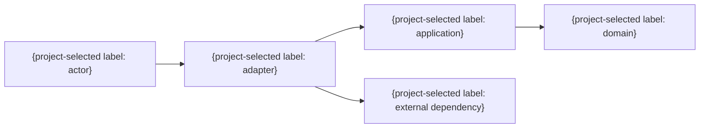

# 全体アーキテクチャ

状態: {提案 / 承認済み}（確認者: {役割}、根拠: {Issue・PR等}）

> 任意の詳細雛形。既存の仕様・書式・ID・設計を優先する。必要な項目だけ使う。例の構成・値は確定仕様ではない。

## 構成の選択

既存設計の責務・依存方向・業務不変条件を確認する。次の図は層分離の一例である。DDDや専用層の新設は強制しない。認可と業務判定を実際に強制する境界を明示する。

| コンポーネントID | 責務 | 入力 | 出力 | 許可依存 | 禁止依存 | 障害時の振る舞い |
|---|---|---|---|---|---|---|
| CMP-001 | {単一責務} | {入力} | {出力} | {依存先} | {依存先} | {影響・復旧} |

- 設計判断: {選択肢、採用理由、トレードオフ。長期的な判断理由が既存資料に残らない場合だけADRにする}
- 技術スタック・基盤の選定根拠: {必要な能力、制約、不採用案、版管理方針。製品名だけを結論にしない}
