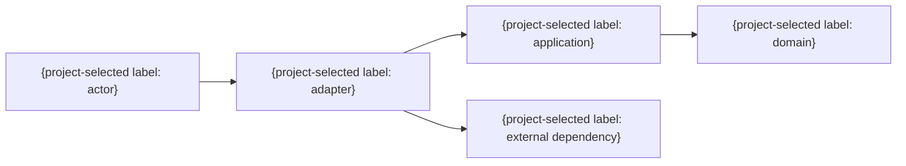

# 全体アーキテクチャ

> 任意の詳細雛形。既存仕様・書式・ID・設計を優先し、必要な項目だけ利用する。全カテゴリの生成・読込みは不要。例の構成・値を未確認の確定仕様として扱わない。

## 構成の選択

既存設計の責務・依存方向・業務不変条件を確認する。次の図は層分離の一例であり、DDDや専用層の新設を強制しない。認可と業務判定を実際に強制する境界を明示する。

| コンポーネントID | 責務 | 入力 | 出力 | 許可依存 | 禁止依存 |
|---|---|---|---|---|---|
| CMP-001 | {単一責務} | {入力} | {出力} | {依存先} | {依存先} |

- 技術スタック・基盤の選定根拠: {必要な能力、制約、不採用案、版管理方針。製品名だけを結論にしない}
