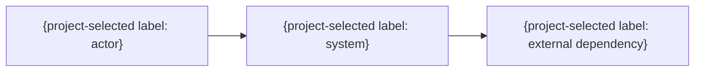

# システムコンテキスト

> 任意の詳細雛形。既存仕様・書式・ID・設計を優先し、必要な項目だけ利用する。全カテゴリの生成・読込みは不要。例の構成・値を未確認の確定仕様として扱わない。

| 接続先 | 目的 | 契約 | データ | 信頼区分 | 障害時 |
|---|---|---|---|---|---|
| {名称} | {目的} | {API等} | {データ} | 信頼しない / 条件付き | {縮退} |
