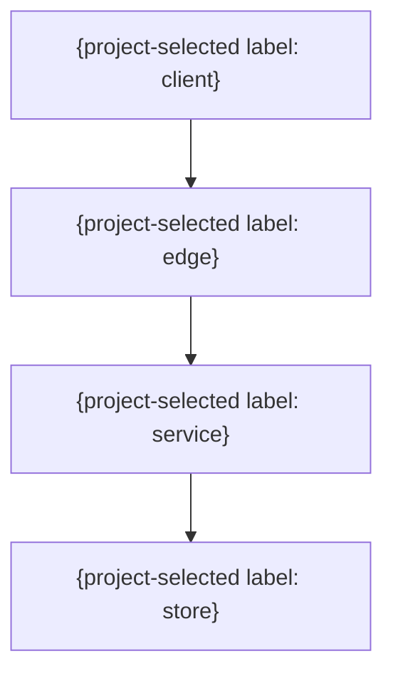

# 配置・依存

状態: {提案 / 承認済み}（確認者: {役割}、根拠: {Issue・PR等}）

> 任意の詳細雛形。既存仕様・書式・ID・設計を優先し、必要な項目だけ利用する。全カテゴリの生成・読込みは不要。例の構成・値を未確認の確定仕様として扱わない。

| 配置単位 | 配備環境（ENV ID） | 責務 | 依存 | 配備ノード（NODE ID） |
|---|---|---|---|---|
| {単位} | {ENV-...} | {責務} | {依存} | {NODE-...} |

台数・スケール・冗長化・障害影響は[物理・配備構成](../09_基盤・ネットワーク/02_物理・配備構成.md)を正本とする。

