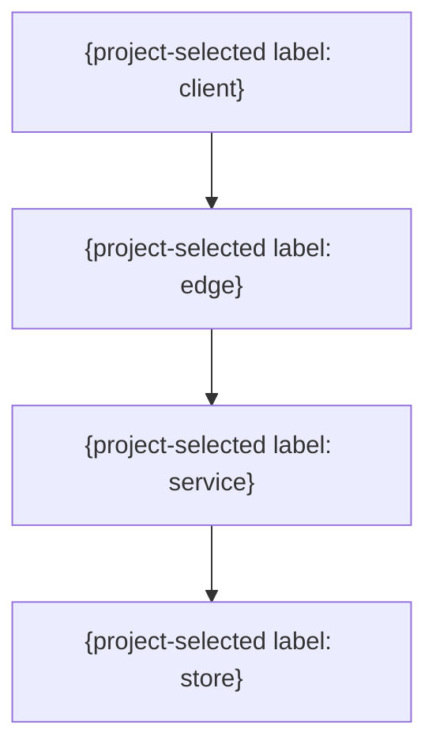

# 配置・依存

> 任意の詳細雛形。既存仕様・書式・ID・設計を優先し、必要な項目だけ利用する。全カテゴリの生成・読込みは不要。例の構成・値を未確認の確定仕様として扱わない。

| 配置単位 | 実行環境 | 責務 | 依存 | スケール | 障害分離 |
|---|---|---|---|---|---|
| {単位} | {環境} | {責務} | {依存} | {方式} | {境界} |

