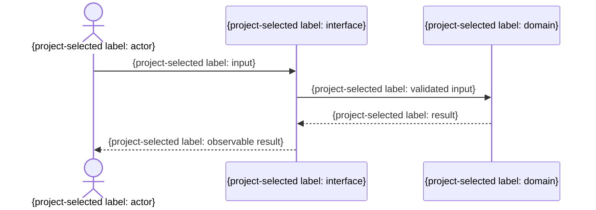

# FN-XXX 個別機能仕様

状態: {提案 / 承認済み}（確認者: {役割}、根拠: {Issue・PR等}）

> 任意の詳細雛形。既存仕様・書式・ID・設計を優先し、必要な項目だけ利用する。全カテゴリの生成・読込みは不要。例の構成・値を未確認の確定仕様として扱わない。

- 目的: {利用者価値}
- 関連要件: {REQ-{domain}-...}
- 関連ユースケース: {UC ID。対応の正本は既存の要件追跡先（必要なら`15_要件追跡/00_追跡表.md`）}
- 主体: {ACT ID}。必要な権限は[信頼境界・認証認可](../10_セキュリティ/01_信頼境界・認証認可.md)を正本とする
- 前提条件: {条件}
- 入力: {形式・制約}
- 出力: {形式・制約}
- 正常時: {振る舞い}
- 失敗時: {状態・表示・変更されないもの}
- 不変条件: {この機能だけの条件。業務全体の規則は[業務規則](../01_システム概要/01_業務・利用者フロー.md)のBR IDで参照する}
- 互換性: {方針}
- 対象外: {CON ID。[制約・前提・対象外](../02_要件/02_制約・前提・対象外.md)を正本とする}

図が必要ならプロジェクト規約が選択した表示言語を注入し、主体、境界、検証済み入出力を示す。次の図は構造だけを示すhookであり、表示名とmessageは置換する。

- 受け入れ条件: {AC ID}。条件の正本は[受け入れ条件](../02_要件/01_受け入れ条件.md)、テストとの対応は[要件追跡表](../15_要件追跡/00_追跡表.md)とする
