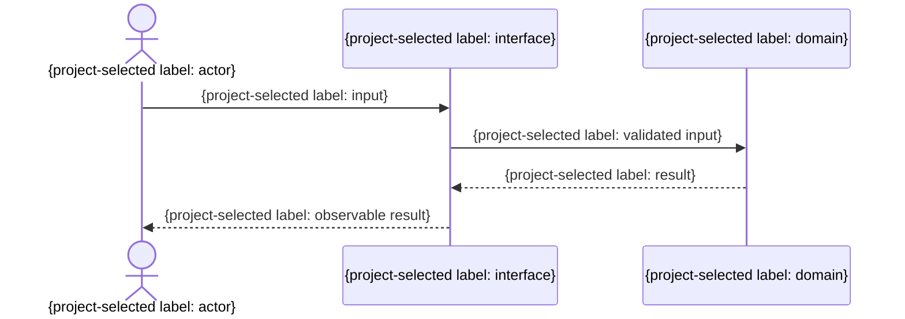

# FN-XXX 個別機能仕様

> 任意の詳細雛形。既存仕様・書式・ID・設計を優先し、必要な項目だけ利用する。全カテゴリの生成・読込みは不要。例の構成・値を未確認の確定仕様として扱わない。

- 目的: {利用者価値}
- 関連要件: {REQ-{domain}-...}
- 関連ユースケース: {UC ID。対応の正本は既存の要件追跡先（必要なら`15_要件追跡/00_追跡表.md`）}
- 主体・権限: {主体・権限}
- 前提条件: {条件}
- 入力: {形式・制約}
- 出力: {形式・制約}
- 正常時: {振る舞い}
- 失敗時: {状態・表示・変更されないもの}
- 不変条件: {条件}
- 互換性: {方針}
- 対象外: {範囲}

図が必要ならプロジェクト規約が選択した表示言語を注入し、主体、境界、検証済み入出力を示す。次の図は構造だけを示すhookであり、表示名とmessageは置換する。

| 受け入れ条件 | 既存テスト参照 | テスト層 |
|---|---|---|
| {条件} | {テストID・パス等} | {この条件を検証する層} |
