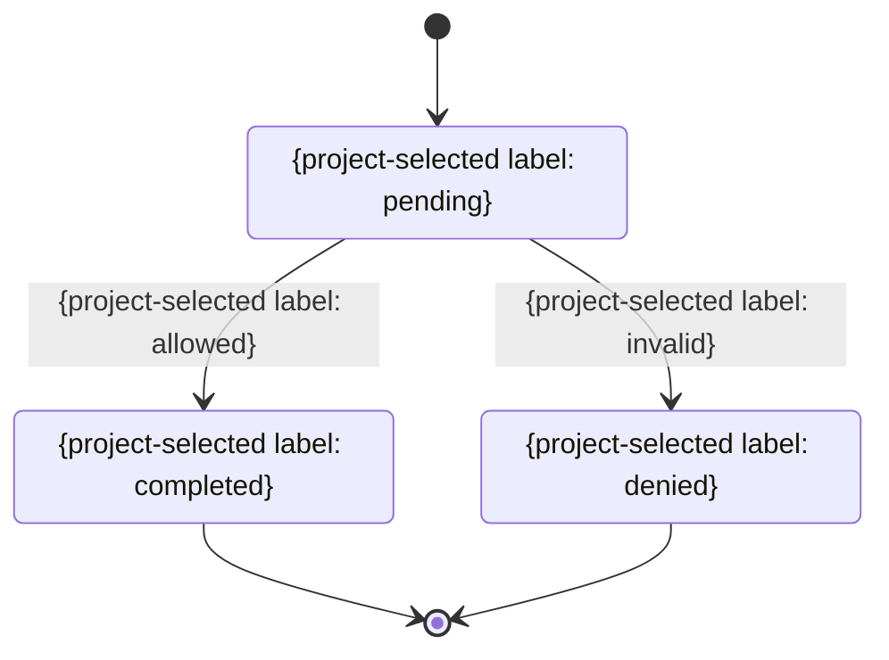

# 状態遷移

> 任意の詳細雛形。既存仕様・書式・ID・設計を優先し、必要な項目だけ利用する。全カテゴリの生成・読込みは不要。例の構成・値を未確認の確定仕様として扱わない。

| 現在状態 | 操作 | ガード条件 | 次状態 | 副作用 | 失敗時 |
|---|---|---|---|---|---|
| {状態} | {操作} | {条件} | {状態} | {変更} | 状態を変更しない |
