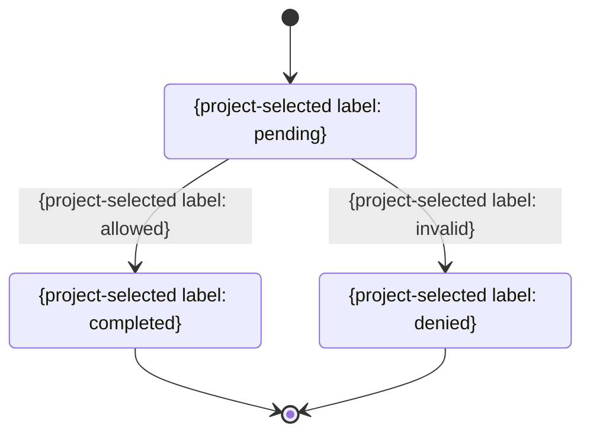

# 状態遷移

状態: {提案 / 承認済み}（確認者: {役割}、根拠: {Issue・PR等}）

> 任意の詳細雛形。既存の仕様・書式・ID・設計を優先する。必要な項目だけ使う。例の構成・値は確定仕様ではない。

| 現在状態 | 操作 | ガード条件 | 次状態 | 副作用 | 失敗時 |
|---|---|---|---|---|---|
| {状態} | {操作} | {条件} | {状態} | {変更} | 状態を変更しない |
