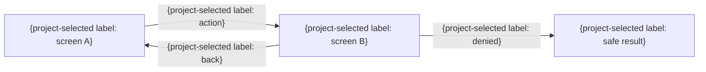

# 画面遷移

状態: {提案 / 承認済み}（確認者: {役割}、根拠: {Issue・PR等}）

> 任意の詳細雛形。既存の仕様・書式・ID・設計を優先する。必要な項目だけ使う。例の構成・値は、確認するまで確定仕様として扱わない。書き方は[利用案内](../../00_利用案内.md#書き方)に従う。

| 遷移元 | 操作 | 条件・権限 | 遷移先 | データ保持 | 失敗時 |
|---|---|---|---|---|---|
| SCR-001 | {操作} | {条件} | SCR-002 | {保持} | {表示・遷移} |
