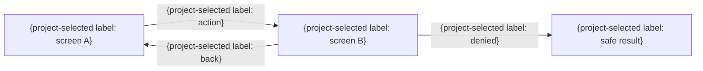

# 画面遷移

> 任意の詳細雛形。既存仕様・書式・ID・設計を優先し、必要な項目だけ利用する。全カテゴリの生成・読込みは不要。例の構成・値を未確認の確定仕様として扱わない。

| 遷移元 | 操作 | 条件・権限 | 遷移先 | データ保持 | 失敗時 |
|---|---|---|---|---|---|
| SCR-001 | {操作} | {条件} | SCR-002 | {保持} | {表示・遷移} |
