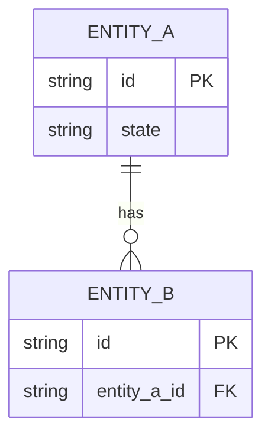

# データモデル

状態: {提案 / 承認済み}（確認者: {役割}、根拠: {Issue・PR等}）

> 任意の詳細雛形。既存の仕様・書式・ID・設計を優先する。必要な項目だけ使う。例の構成・値は、確認するまで確定仕様として扱わない。書き方は[利用案内](../../00_利用案内.md#書き方)に従う。

| エンティティ | 責務 | データ（DATA ID） | 識別子（エンティティ単位） | 不変条件 |
|---|---|---|---|---|
| {名称} | {責務} | {DATA-...} | {形式} | {条件} |

データ単位の所有者・正本・識別子は[データ一覧](00_データ一覧.md)を正本とする。ここにはエンティティ単位の識別子だけを書く。
