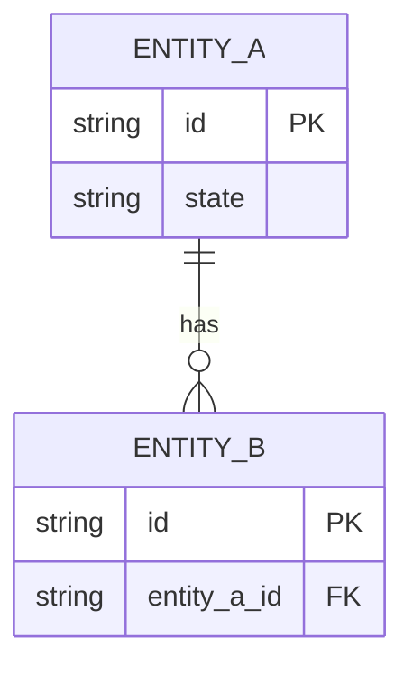

# データモデル

> 任意の詳細雛形。既存仕様・書式・ID・設計を優先し、必要な項目だけ利用する。全カテゴリの生成・読込みは不要。例の構成・値を未確認の確定仕様として扱わない。

| エンティティ | 責務 | データ（DATA ID） | 不変条件 |
|---|---|---|---|
| {名称} | {責務} | {DATA-...} | {条件} |

正本の場所と識別子は[データ一覧](00_データ一覧.md)を正本とする。
