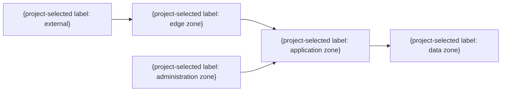

# 論理ネットワーク

> 任意の詳細雛形。既存仕様・書式・ID・設計を優先し、必要な項目だけ利用する。全カテゴリの生成・読込みは不要。例の構成・値を未確認の確定仕様として扱わない。

| 通信ID | 送信元 | 宛先 | 方向 | プロトコル・ポート | 認証・暗号化 | 用途 | 既定拒否 |
|---|---|---|---|---|---|---|---|
| NET-001 | {区画} | {区画} | inbound / outbound | {契約} | {方式} | {用途} | はい |
