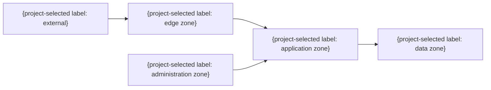

# 論理ネットワーク

状態: {提案 / 承認済み}（確認者: {役割}、根拠: {Issue・PR等}）

> 任意の詳細雛形。既存の仕様・書式・ID・設計を優先する。必要な項目だけ使う。例の構成・値は、確認するまで確定仕様として扱わない。書き方は[利用案内](../../00_利用案内.md#書き方)に従う。

| 通信ID | 送信元 | 宛先 | 方向 | プロトコル・ポート | 認証・暗号化 | 用途 | 既定拒否 |
|---|---|---|---|---|---|---|---|
| NET-001 | {区画} | {区画} | inbound / outbound | {契約} | {方式} | {用途} | はい |
