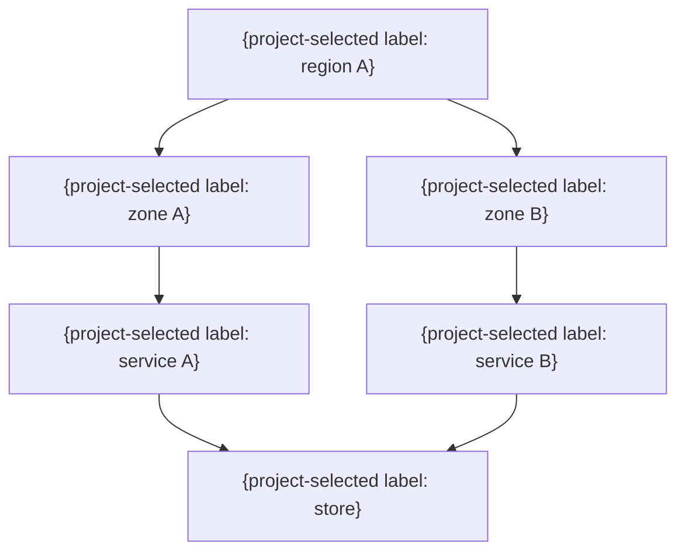

# 物理・配備構成

状態: {提案 / 承認済み}（確認者: {役割}、根拠: {Issue・PR等}）

> 任意の詳細雛形。既存の仕様・書式・ID・設計を優先する。必要な項目だけ使う。例の構成・値は確定仕様ではない。

配備ノードの台数・スケール・冗長化・障害分離の境界・障害影響・復旧の正本。

| ノードID | 配置 | 役割 | 台数・スケール | 冗長化 | 障害分離の境界 | 障害影響 | 復旧 |
|---|---|---|---|---|---|---|---|
| NODE-001 | {場所} | {役割} | {条件} | {方式} | {境界} | {範囲} | {方式} |
