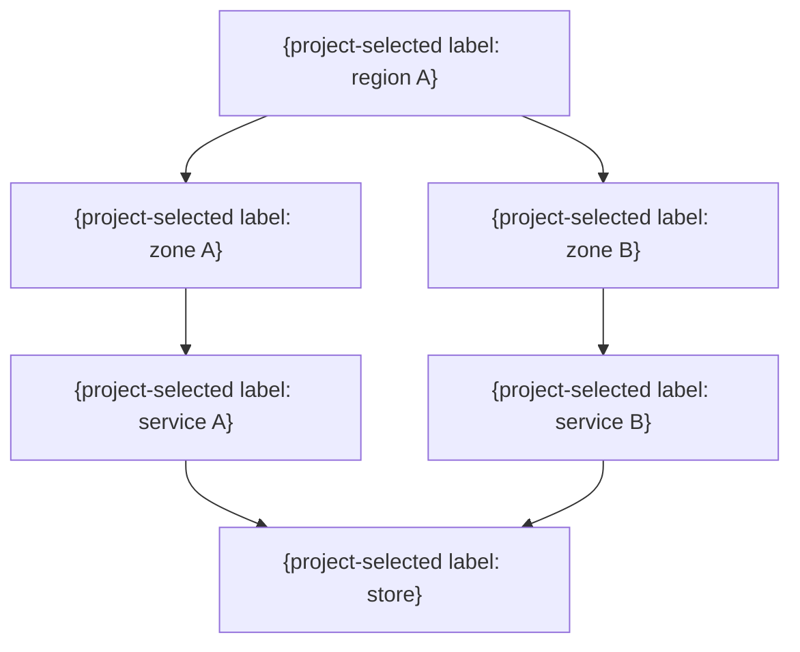

# 物理・配備構成

> 任意の詳細雛形。既存仕様・書式・ID・設計を優先し、必要な項目だけ利用する。全カテゴリの生成・読込みは不要。例の構成・値を未確認の確定仕様として扱わない。

| ノードID | 配置 | 役割 | 台数・スケール | 冗長化 | 障害影響 | 復旧 |
|---|---|---|---|---|---|---|
| NODE-001 | {場所} | {役割} | {条件} | {方式} | {範囲} | {方式} |
