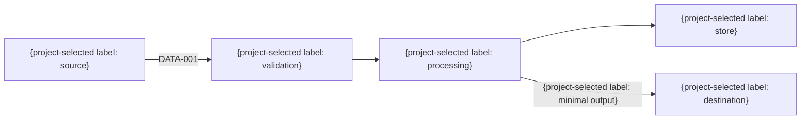

# データフロー

状態: {提案 / 承認済み}（確認者: {役割}、根拠: {Issue・PR等}）

> 任意の詳細雛形。既存仕様・書式・ID・設計を優先し、必要な項目だけ利用する。全カテゴリの生成・読込みは不要。例の構成・値を未確認の確定仕様として扱わない。

| フローID | データ | 送信元 | 境界・検証 | 宛先 | 暗号化 | 中継での一時保持 | 監査 |
|---|---|---|---|---|---|---|---|
| FLOW-001 | {DATA ID} | {元} | {検証} | {先} | 保存時 / 通信時 | {中継先・期間} | {証拠} |

業務データの保持期間は[データライフサイクル](../07_データ/03_ライフサイクル.md)を正本とする。この表には、中継先だけで一時的に保持する期間を書く。
