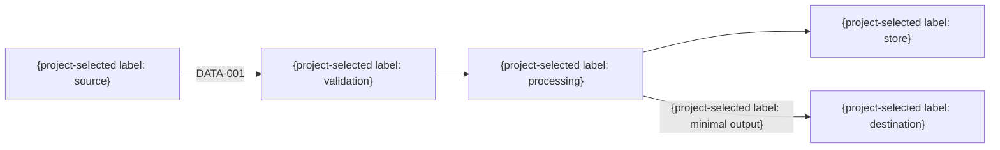

# データフロー

> 任意の詳細雛形。既存仕様・書式・ID・設計を優先し、必要な項目だけ利用する。全カテゴリの生成・読込みは不要。例の構成・値を未確認の確定仕様として扱わない。

| フローID | データ | 送信元 | 境界・検証 | 宛先 | 暗号化 | 保持 | 監査 |
|---|---|---|---|---|---|---|---|
| FLOW-001 | {DATA ID} | {元} | {検証} | {先} | 保存時 / 通信時 | {期間} | {証拠} |
